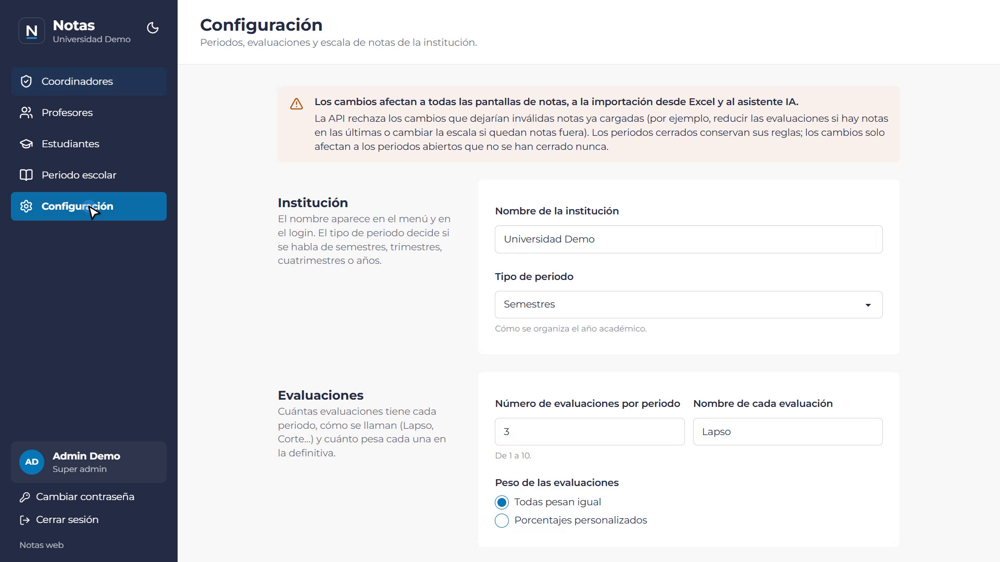
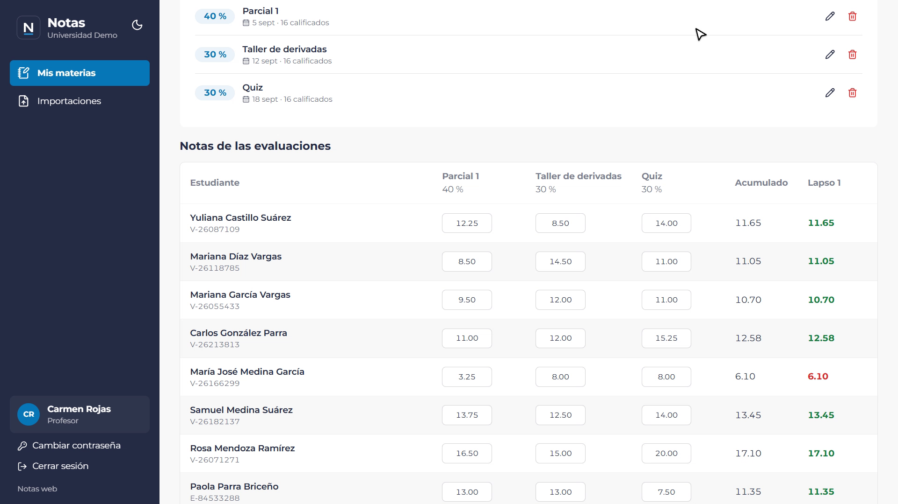
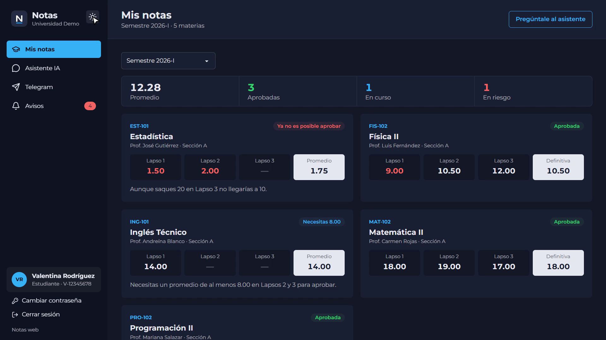
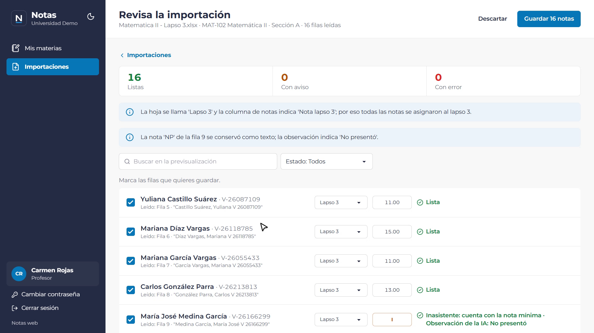

## Why

In many schools, grades live in spreadsheets. Every teacher has their own, with their own columns and habits, and at the end of each term someone copies them by hand into another system. Meanwhile, students do not know how they are doing until someone publishes the list, or they ask the teacher directly.

On top of that, no two schools are alike: some work in semesters and others in trimesters, some grade from 1 to 20 and others from 1 to 10, and each one splits the period into terms with different weights. A system with those rules fixed in the code would only serve one of them.

## How

**Notas** is two pieces, each in its own public repository: a **FastAPI API** ([ia-grades-loader-api](https://github.com/anibalmd32/ia-grades-loader-api)) with async SQLAlchemy, MySQL and Alembic migrations, and a **React app** ([ia-grades-loader-ui](https://github.com/anibalmd32/ia-grades-loader-ui)) with TanStack Router, Query and Form. The same app runs in the browser, as a Windows program and as an Android app thanks to **Tauri 2**; on Android it unlocks with a fingerprint. The app is in Spanish, and the screenshots use the project's demo data.

There are four roles. The super admin installs the system and defines the academic rules, coordination organises the period into sections and assigns one teacher per subject and section, teachers load grades and students look them up. There is no public sign-up: every account is created by someone in the role above.

*The school's rules are set from the app, without touching code.*

A teacher can type grades into the sheet or define an evaluation plan per term (exams, workshops, quizzes, each with its percentage); then the term grade calculates itself. A student who does not show up is marked absent and counts with the lowest grade on the scale.

*With an evaluation plan, the term grade comes from its evaluations.*

Every time a grade is loaded or corrected, the student gets an instant notice through Server-Sent Events, and the app shows it as a system notification.

*Each subject says how the student is doing and what is left to pass.*

## Challenges

### A spreadsheet in any format

The teacher uploads their sheet as it is. Reading it with an AI model takes a while, so the API answers right away with a queued job and a worker processes it in the background. The queue is a table in MySQL, with no Redis or any other service to maintain: if the worker goes down, the job is retried.

The model does not write to the database. It only extracts what it sees: ID number, name, term and grade for each row. Then the system checks every row against the students enrolled in that subject and section. It matches by ID number, and if there is none, by name (with a warning so the teacher confirms it). It also checks that the grade is within the scale, rounds it to the allowed decimals, reads "I" or "NP" as absences and catches repeated grades. The teacher sees every row marked as ready, with a warning or with an error, next to the grade it already had, and decides what to save.

*The AI explains how it read the file; the teacher confirms before saving.*

### An assistant that only sees your grades

Students can ask "how am I doing in Physics II?" or "what do I need to pass?". The model is not given the database: it has two tools, the grade summary and the grades of one subject, and it calls them when it needs them. What matters is whose grades those are: the student's id comes from the session and never from the arguments the model proposes, so no question can return someone else's grades. There is a limit on questions per minute.

The same tools are exposed through an **MCP** server (FastMCP) mounted on the API, authenticated with the student's token, and through a **Telegram** bot. To link Telegram, the app generates a single-use link that expires, and only the code's hash is stored in the database.

### Rules that change without rewriting the past

If a school changes its scale or the weight of its terms, grades from closed periods should not be recalculated with the new rules. The rules are edited in one place, and when a period closes they are copied into it: from then on every subject is validated with its own period's rules, and a closed period can no longer be changed. That is why the app has no fixed wording: "Term", "Cut", the scale and the passing grade all come from the settings.

### What was left out

The system is not deployed to production yet, and the quality of the import depends on the chosen model: it has not been measured with real data. The API talks to any OpenAI-compatible provider (DeepSeek by default), so changing models means changing a variable. The Windows installer is not signed yet.
