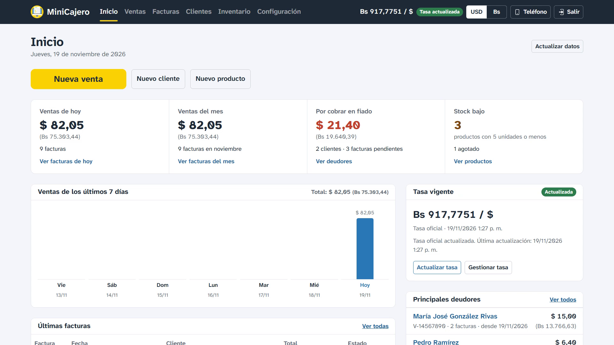
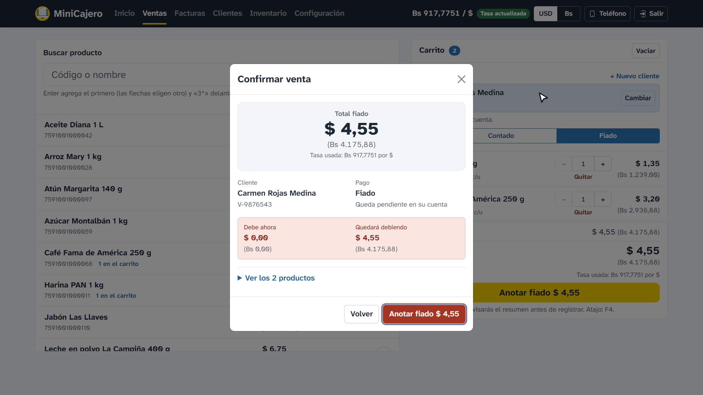
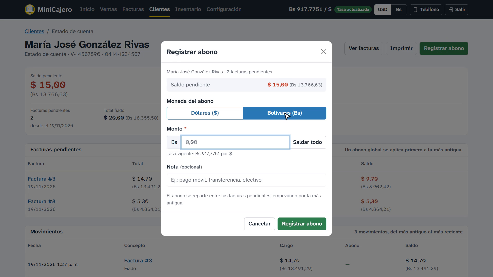
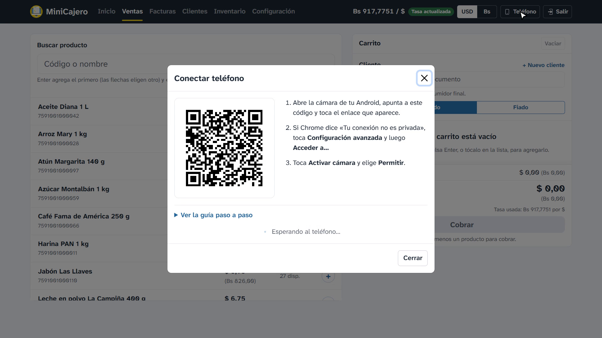

## Why

In a Venezuelan corner shop, the owner charges at the counter themself, almost always with people waiting. Prices are in dollars, but many customers pay in bolívares, so every sale goes through the calculator with the day's exchange rate. Trusted customers buy on credit, and that debt lives in a notebook. Stock gets counted by hand when there is time.

The billing systems out there are built for companies: several users, roles, a cloud server and a monthly subscription. For one person, with a modest laptop and a connection that drops, most of that is too much. MiniCajero succeeds if charging a sale is faster than writing it in the notebook.

## How

**MiniCajero** is a **Bun** server in strict TypeScript that only listens on `127.0.0.1` and stores everything in **SQLite** through the native `bun:sqlite` module. Opening it from the shortcut starts it and opens the default browser; if it was already running, it just opens another tab. The only runtime dependency is **Bootstrap**: no ORM, no framework, no PDF or icon libraries. The app is in Spanish, and the screenshots use demo data.

*The home screen says how much was sold, how much is owed and what is running out.*

Selling is the shortest path in the app. You search for or scan the product, Enter adds it to the cart and F4 charges, all without touching the mouse. Every amount shows in dollars and bolívares, and the sale is blocked if there is not enough stock. The official rate syncs on start and every three hours; with no internet, the bar says so and the owner can set a manual rate. With no rate at all, nothing can be sold.

*Before recording a credit sale, the app shows how much the customer will owe.*

Credit has no limit. Each customer has a statement, and a payment can be recorded in dollars or in bolívares: it is split across the pending invoices, oldest first. Invoices and statements print from the browser on letter paper or as a receipt, or are saved as PDF.

*A payment in bolívares is converted at the day's rate and reduces the debt in dollars.*

## Challenges

### The phone as a scanner

A barcode reader costs money, and the owner already has an Android phone with a camera. The problem is that the phone's browser only opens the camera on a secure page, and the app only listens on the PC, without HTTPS.

When you ask for the QR code, the app starts a **second HTTPS server** on the local network that only serves the scanner page and its WebSocket; everything else gets a 404. It shuts itself down after 15 minutes with no phones. The certificate is a self-signed EC P-256 one, and I build it byte by byte in DER, without OpenSSL, with the machine's local IP addresses. I also draw the QR code myself, with its Reed-Solomon error correction, to avoid adding dependencies.

*You scan the QR code once, and every code read reaches the Sales or Stock tab.*

The QR code carries a single-use token that expires after 10 minutes and travels in the URL fragment, so it never shows up in any log. The database only stores hashes. Five failed attempts block that IP. Each read goes to the Sales or Stock tab used most recently, and the phone gets the answer in under five seconds: "Harina PAN · 2 in the cart" or "Out of stock".

### Two currencies with no rounding errors

With a rate of hundreds of bolívares per dollar, a floating-point error shows on the receipt. Amounts are stored as integers, in dollar cents and bolívar cents. Conversion with the rate, which has up to four decimals, uses `BigInt`, and all rounding follows a single rule.

Product prices only exist in dollars. Invoices, on the other hand, store both amounts and the rate used at the time of the sale, and they are never recalculated. A sale and a payment run inside an SQLite `IMMEDIATE` transaction: one test fires sales from several threads at once and checks that no invoice number repeats.

### One file and nothing else

The owner is not going to install Node, a database or dependencies. `bun build --compile` produces a single `minicajero.exe` with the HTML, CSS, Bootstrap and the typeface inside, and no console window. A **Rust installer**, written with Microsoft's `windows` crate, installs it for the current user only, without admin rights, and creates the shortcuts. The uninstaller asks whether to delete the data and, by default, keeps it.

A power cut should not cost sales. Every day the app makes a backup with `VACUUM INTO`, which copies the whole database without leaving half-written files, and keeps the 14 most recent. A backup is checked with `PRAGMA integrity_check` before it is restored.

### What was left out

MiniCajero does not issue invoices that are valid for tax purposes. For now it is for my own use, with a single user; if it works, the plan is to move it to a native app with Tauri. The Windows installer is not signed yet, and the first time, Chrome on the phone warns that the certificate is not trusted.
