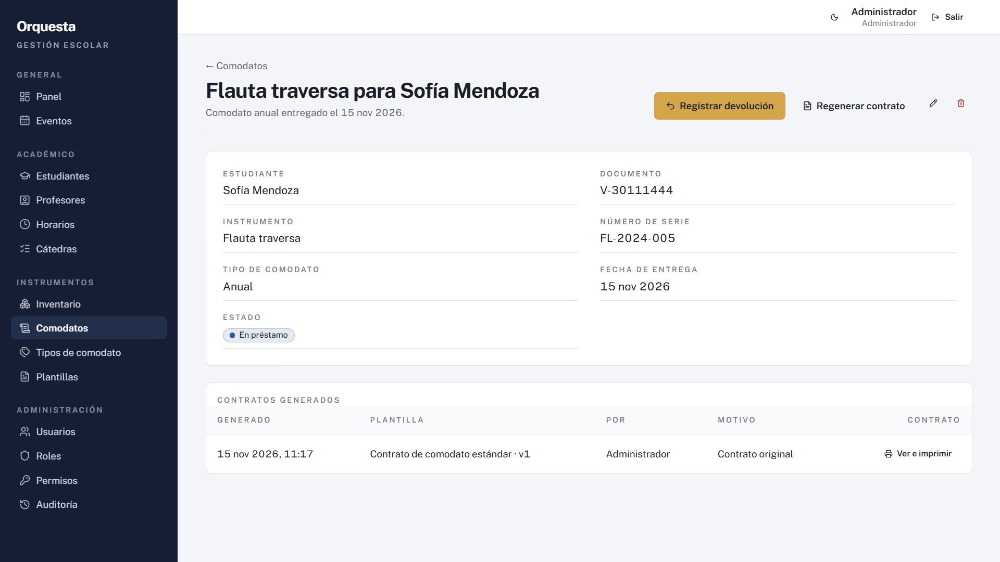
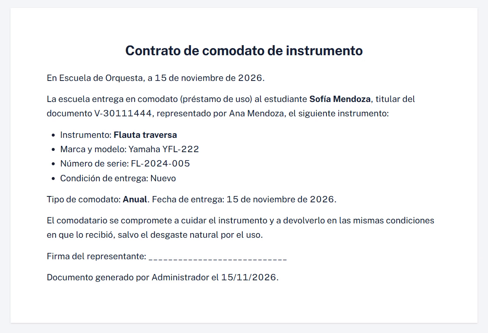
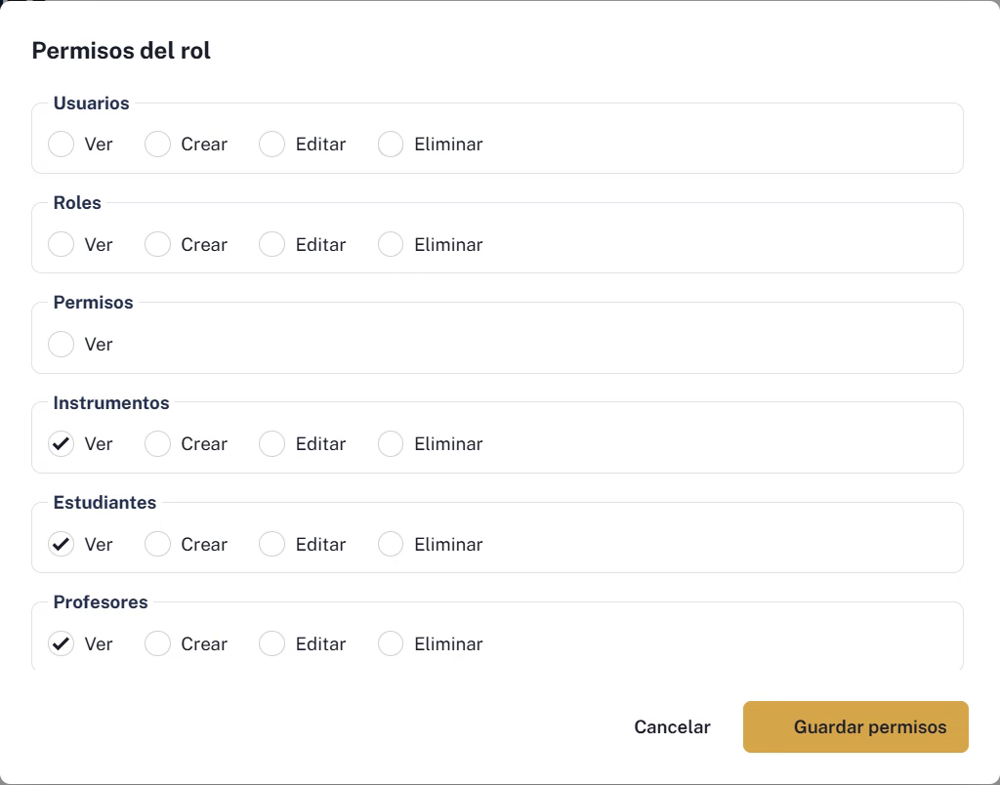
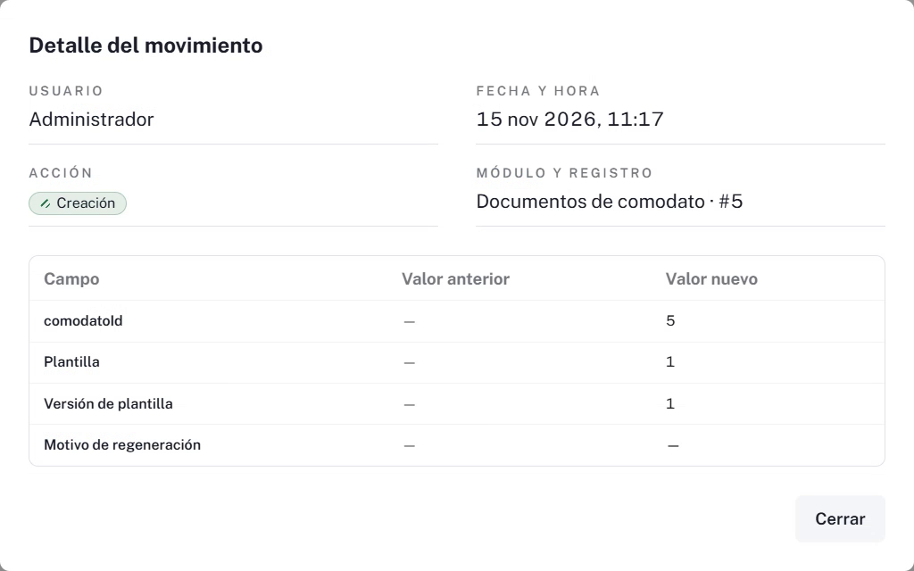
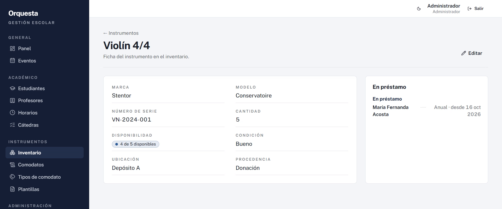

## Why

An orchestra school lends instruments, and it lends a lot of them: violins, cellos, flutes and clarinets that children and teenagers take home to practise. Every loan is a **comodato**, a loan-for-use contract signed by a parent or guardian. Every instrument has a brand, a serial number, a condition and a place where it should be.

In many schools all of that lives on paper and in loose spreadsheets. The result is the usual one: nobody knows for sure how many violins are still free, the contract is written by hand every time, and when something changes there is no trace of who changed it or when.

Before writing code I wrote down the problem. I made one document for each part of the system (access, users and permissions, instruments, students, teachers, schedules, loans, events, audit and dashboard) with its use cases and rules, and another one on how to build it. Those ten pairs of documents were the map for everything that came after.

## How

Orquesta has gone through three versions. The first was a Laravel and Inertia monolith; the second, a NestJS API with a Next.js client. The current one is **a single NestJS application running on Bun** that builds every page on the server with **hono/jsx**. **htmx** handles the dynamic parts (filters, forms, dialogs) by asking for fragments of HTML, with no framework in the browser. The data lives in **MySQL** through **Drizzle ORM**, input is validated with **Zod**, and the interface uses **Tailwind CSS** and **daisyUI**.

The code is organised by module (students, instruments, loans, templates, audit…), and each module keeps domain, use cases, infrastructure and presentation apart, with one use case per file. The app is in Spanish, and the screenshots use the project's demo data.

*A loan record: who has it, which instrument, since when, and every contract that was generated, with its reason.*

### The contract is written once

The loan is the heart of the system. An administrator writes the contract in an editor that works like any word processor, built with TipTap, and wherever it is needed inserts details of the student, the instrument or the loan. They are not typed by hand: they are picked from a catalogue and sit in the text as chips that stand apart from the rest. A preview with sample data shows how it will look.

When a loan is recorded, the server fills in each detail with the real information (name, ID number, guardian, serial number, the date in long form) and stores the result as a fixed copy, along with the version of the template it came from. That copy is the one that counts: if the template changes tomorrow, contracts already signed stay as they were. If one needs fixing, it is generated again and the previous one is kept along with the reason for the change.

*The generated contract, ready to print or save as a PDF from the browser.*

### Everyone sees their own part

There are three roles: administration, coordination and teachers. Every route asks for a specific permission (view, create, edit or delete), module by module. A teacher only sees the students and loans of their own schedule, and that rule holds both in the lists and when someone tries to open a record directly by its address. The side menu is built from the permissions of whoever signs in, so nobody sees options they cannot use.

*A role's permissions, grouped by module.*

### Nothing changes without a trace

Every creation, edit or deletion is recorded with who did it, when, and the old and new value of the fields that changed. Passwords and the content of contracts are never copied into the audit log. Sign-ins and sign-outs are recorded too.

*An entry in the audit log: the administrator generated the contract of loan #5.*

## Challenges

### Two loans for the last violin

An instrument can have several units, and the rule is simple: never lend more than there are. The problem shows up when two people record a loan of the same instrument at the same time and only one unit is left. If both check availability before the other one saves, both see "1 available" and both lend it.

The fix was to create the loan inside a transaction that locks the instrument's row (`SELECT … FOR UPDATE`) while it counts the active loans. The second request waits its turn, finds zero units and gets a clear message.

*Each instrument shows how many units are free and who it was lent to.*

### One transaction, never passed around

Recording a loan touches three things: the loan, its contract and its audit entry. Either all three are saved, or none is. The obvious way out, passing the transaction as a parameter through every repository, fills the code with noise, and one slip is enough to write outside it. I used Node's asynchronous context (`AsyncLocalStorage`): when a transaction opens, it is stored in that context, and every repository writes into it without knowing. If one use case calls another, the second joins the first one's transaction instead of opening a new one.

### Signing out for real

The session is not a token the browser keeps on its own: it lives in the database. The cookie carries a random value, `httpOnly`, and the database stores only its SHA-256 hash, so a copy of the database is no way in. Signing out deletes that row; changing the password or deleting the user deletes all of their sessions, and access ends right then. Because the user and their permissions are loaded on every request, someone who loses a permission notices on their next click.

### A template is HTML someone typed

The contract is stored as HTML, and whatever is stored gets shown again. When a template is saved, the server cleans it with Bun's `HTMLRewriter`: only text, list and table tags get through, and everything else is dropped. When the contract is generated, each variable's value is escaped before it goes into the text. On top of that, the page has a strict content policy (`script-src 'self'`) and htmx runs without `eval`.

### What was left out

The PDF is not generated on the server. The contract is stored as HTML and printed or saved as a PDF from the browser; that was a deliberate choice, to avoid depending on a headless browser running on the server. The interface is in Spanish only.
