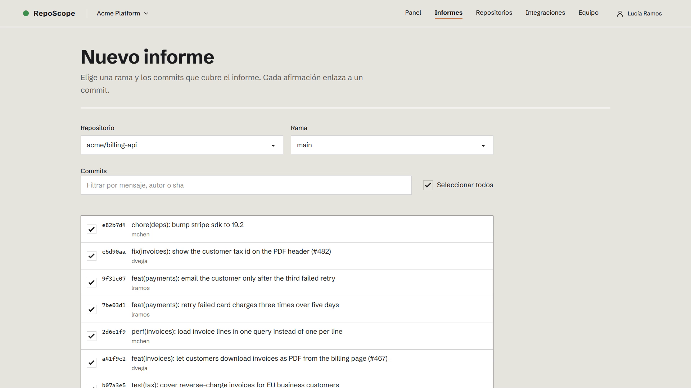
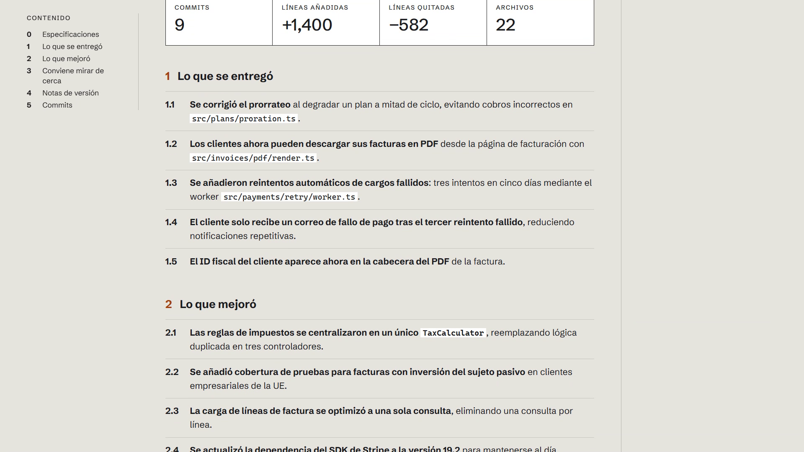
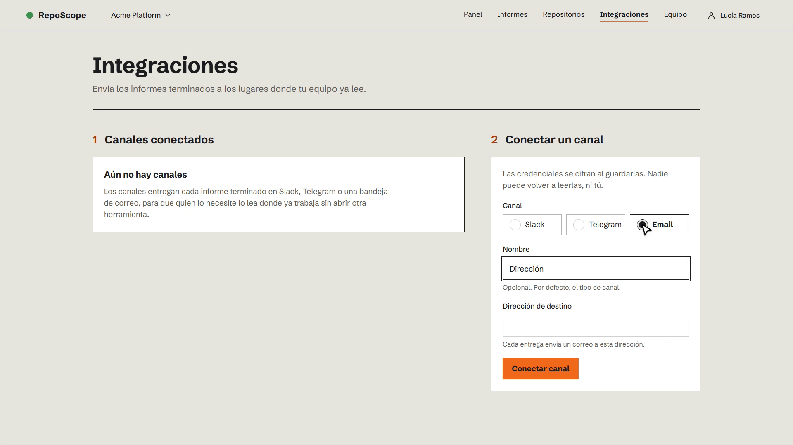
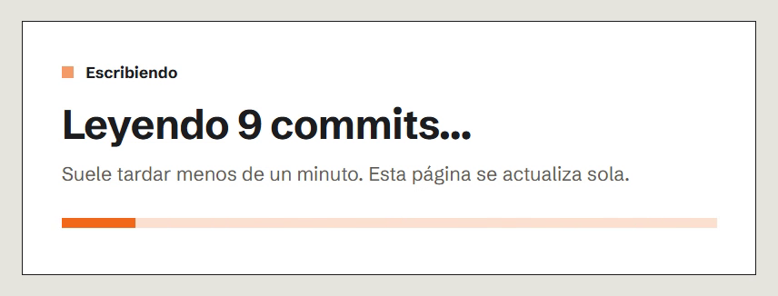
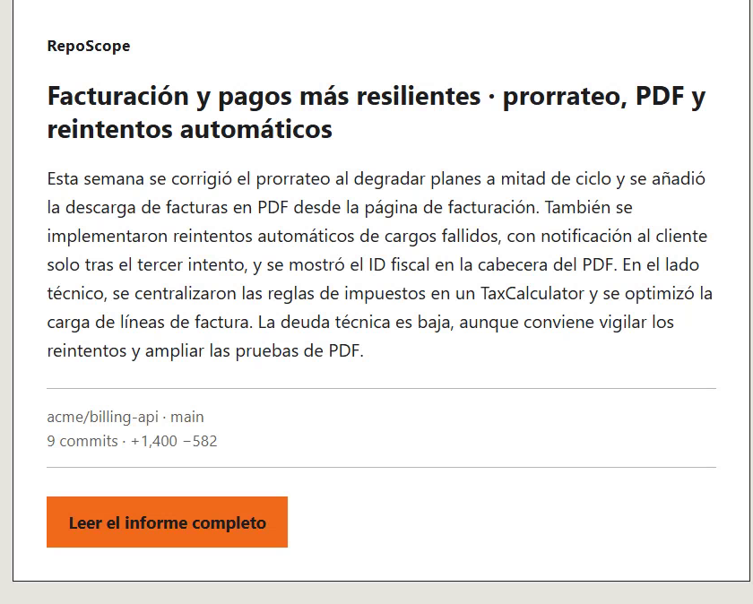

## Why

Every week or every sprint, someone on a software team has to explain what shipped to people who did not follow the work closely: product, management, an internal client. That person lives in GitHub, but their audience does not read commits or diffs.

Writing that report by hand takes a while, and it carries a less visible risk: what gets told from memory does not always match what was actually pushed. RepoScope starts from the real commits and keeps every claim tied to one of them.

## How

The flow has few steps. You connect GitHub repositories to a team workspace, pick a branch and tick the commits you want to cover, up to 50. The report comes out in four sections (what shipped, what improved, worth a closer look, and release notes), in the language you choose for that report: English or Spanish. The app and the screenshots here are in Spanish.

*New report: repository, branch and the commits it will cover.*

It is an **Astro** monolith in SSR mode, ready for Vercel, with **Supabase** for the database and authentication (email, GitHub OAuth and TOTP two-factor). There is no client-side framework: screens are forms rendered on the server, and the only truly interactive one, the commit picker, is a TypeScript *custom element*. Before choosing it I tried the three options on that same screen: the custom element shipped 0.6 KB of JavaScript, a Preact island 11.2 KB and Alpine.js 19.1 KB.

There was an earlier version in Laravel, Inertia and React. I rebuilt this one from scratch on Bun, with TypeScript in its strictest mode, Biome and a script of my own that rejects files longer than 150 lines.

### The report is the product

Reading and sharing the report comes before configuring anything. Every point carries its commit's short sha and the lines it added; the index of parts, on the right, lets you jump from any claim to the commit behind it on GitHub.

*Every numbered point can be traced back to its commit.*

The report is shared through a read-only public link, which can be revoked, or printed as a PDF with a print stylesheet. It is also delivered to the channels the team already uses: a Slack webhook, a Telegram bot or email.

*Channels are connected once; their credentials are encrypted when saved.*

## Challenges

### A report that does not make things up

A language model writes well, and for that very reason it can state things the commits do not say. The pipeline does not trust free text: it asks the model (DeepSeek, through the **Vercel AI SDK**) for structured output validated with **Zod**. Then it normalises it: it keeps the template's section order, trims extra points and leaves at most three tags per point.

References to commits are resolved against the list the user picked. If the model cites a sha that is not on that list, the reference simply does not appear. Because the pipeline takes the model as a dependency, the tests run it against a mock model, without calling the real API.

### A minute of work with no server of its own

Generating a report asks GitHub for up to 50 commits and makes a model call that can take a while. The Laravel version used a queue worker, but Vercel has no long-running processes. The action saves the report as pending, answers right away and keeps working with `waitUntil`. The calls to GitHub run in parallel, eight at a time.

*While it writes, the page checks the status every 3 seconds and updates itself.*

So that a reload or a repeated request never starts two generations, the work begins by "claiming" the report: it only moves from `pending` to `generating` if it was still pending, and only one request can win that update.

### Secrets the browser never sees

RepoScope stores GitHub tokens with access to repositories and each channel's settings. They are encrypted in the application with AES-GCM (a random IV per message and a versioned format), and those columns cannot be read with a regular user's role. Every table has row-level security in Postgres: the privileged client is only used on the server, after access has been checked with the user's own client.

*This is how the report arrives by email.*

### What was left out

There is only one provider, GitHub. If the Vercel function dies before it starts, the report stays pending: there are no automatic retries yet. The product is not deployed to production yet, and the videos use a mock GitHub with demo data.
