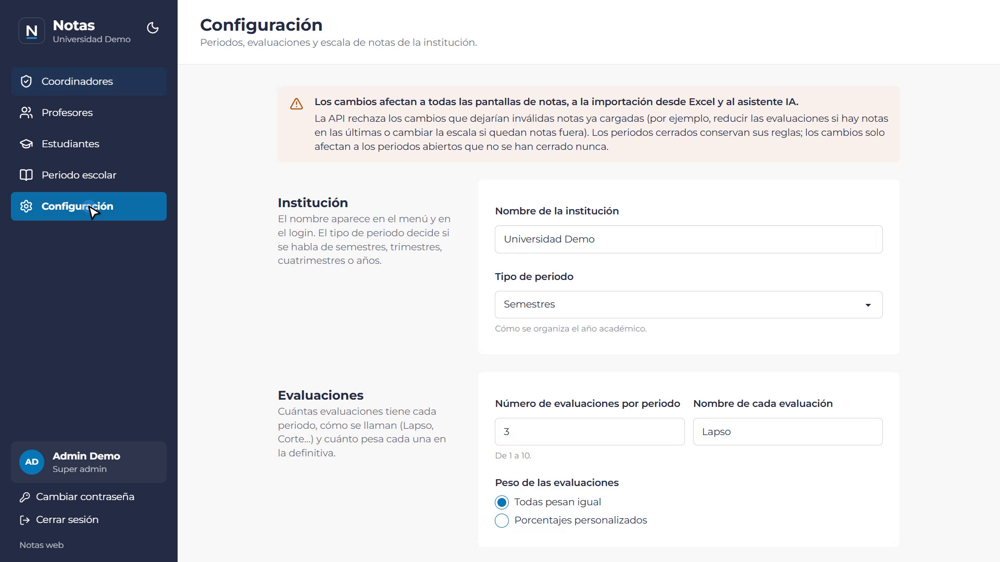
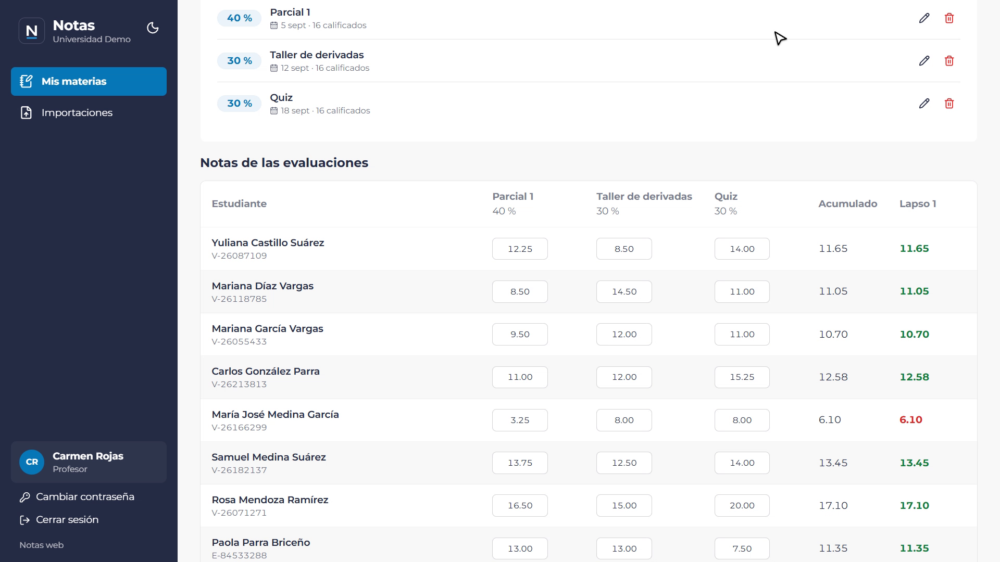
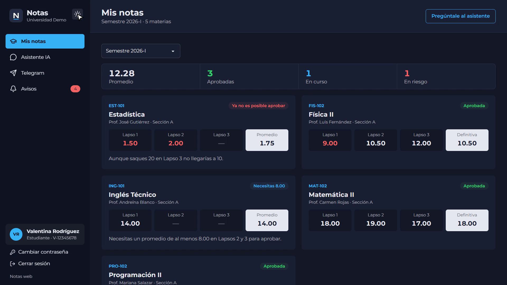
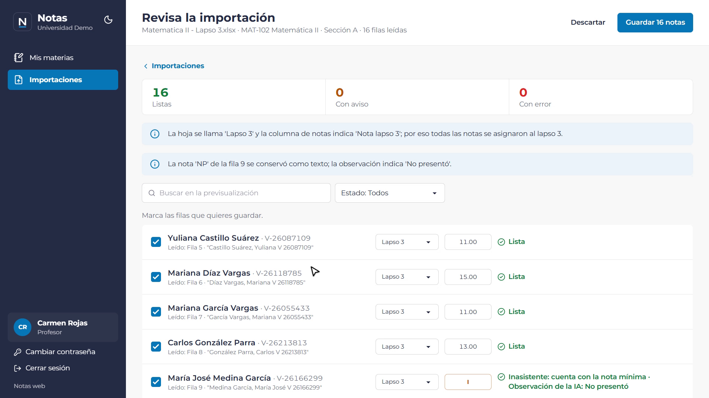

## Por qué

En muchas instituciones las notas viven en hojas de Excel. Cada profesor tiene la suya, con sus columnas y sus costumbres, y al final del lapso alguien las transcribe a mano en otro sistema. Mientras tanto, los estudiantes no saben cómo van hasta que alguien publica la lista, o preguntan directamente al profesor.

Además, ninguna institución se parece a otra: unas trabajan por semestres y otras por trimestres, unas califican del 1 al 20 y otras del 1 al 10, y cada una divide el periodo en lapsos o cortes con pesos distintos. Un sistema con esas reglas fijas en el código solo le serviría a una.

## Cómo

**Notas** son dos piezas, cada una en su repositorio público: una **API en FastAPI** ([ia-grades-loader-api](https://github.com/anibalmd32/ia-grades-loader-api)) con SQLAlchemy asíncrono, MySQL y migraciones con Alembic, y una **app en React** ([ia-grades-loader-ui](https://github.com/anibalmd32/ia-grades-loader-ui)) con TanStack Router, Query y Form. La misma app corre en el navegador, como programa de Windows y como app de Android gracias a **Tauri 2**; en Android se desbloquea con la huella.

Hay cuatro roles. El super admin instala el sistema y define las reglas académicas, la coordinación organiza el periodo en secciones y asigna un profesor por materia y sección, los profesores cargan las notas y los estudiantes las consultan. No existe registro público: cada cuenta la crea alguien del rol de arriba.

*Las reglas de la institución se configuran desde la app, sin tocar código.*

Un profesor puede cargar las notas a mano en la planilla o definir un plan de evaluación por lapso (exámenes, talleres, quices, cada uno con su porcentaje); entonces la nota del lapso se calcula sola. Un estudiante que no se presenta se marca como inasistente y cuenta con la nota mínima de la escala.

*Con un plan de evaluación, la nota del lapso sale de sus evaluaciones.*

Cada vez que se carga o corrige una nota, el estudiante recibe un aviso al instante por Server-Sent Events, y la app lo muestra como notificación del sistema.

*Cada materia dice cómo va el estudiante y qué le falta para aprobar.*

## Desafíos

### Un Excel con cualquier formato

El profesor sube su hoja tal como la tiene. Interpretarla con un modelo de IA tarda, así que la API responde al momento con un trabajo en cola y un worker lo procesa en segundo plano. La cola es una tabla en MySQL, sin Redis ni otro servicio que mantener: si el worker se cae, el trabajo se reintenta.

El modelo no escribe en la base de datos. Solo extrae lo que ve: cédula, nombre, lapso y nota de cada fila. Después el sistema revisa cada fila contra los estudiantes matriculados en esa materia y esa sección. Busca por cédula, y si no la hay, por nombre (con un aviso para que el profesor lo confirme). También valida que la nota esté dentro de la escala, redondea a los decimales permitidos, lee «I» o «NP» como inasistencias y detecta notas repetidas. El profesor ve cada fila marcada como lista, con aviso o con error, junto a la nota que ya tenía, y decide qué guardar.

*La IA explica cómo leyó el archivo; el profesor confirma antes de guardar.*

### Un asistente que solo ve tus notas

Los estudiantes pueden preguntar «¿cómo voy en Física II?» o «¿qué necesito para aprobar?». El modelo no recibe la base de datos: tiene dos herramientas, el resumen de notas y las notas de una materia, y las llama cuando las necesita. Lo importante es de quién son esas notas: el id del estudiante sale de la sesión y nunca de los argumentos que propone el modelo, así que ninguna pregunta puede devolver las notas de otra persona. Hay un límite de preguntas por minuto.

Las mismas herramientas están en un servidor **MCP** (FastMCP) montado en la API, que se autentica con el token del estudiante, y en un bot de **Telegram**. Para vincular Telegram, la app genera un enlace de un solo uso que caduca, y en la base solo se guarda el hash del código.

### Reglas que cambian sin reescribir el pasado

Si una institución cambia la escala o el peso de los lapsos, las notas de periodos ya cerrados no deberían recalcularse con las reglas nuevas. Las reglas se editan en un solo lugar, y al cerrar un periodo se copian dentro de él: desde ese momento cada materia se valida con las reglas de su propio periodo, y un periodo cerrado ya no se puede modificar. Por eso la app no tiene textos fijos: «Lapso», «Corte», la escala y la nota aprobatoria salen de la configuración.

### Lo que quedó fuera

El sistema aún no está desplegado en producción, y la calidad de la importación depende del modelo elegido: no está medida con datos reales. La API habla con cualquier proveedor compatible con OpenAI (DeepSeek por defecto), así que cambiar de modelo es cambiar una variable. El instalador de Windows todavía no está firmado.
