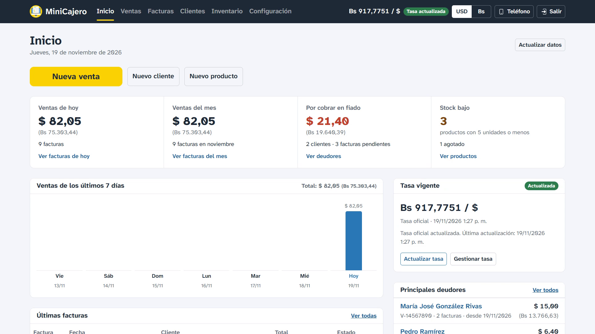
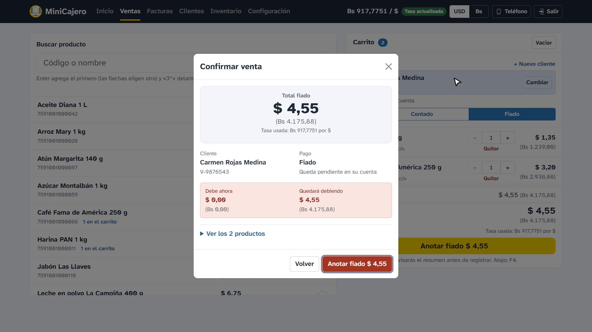
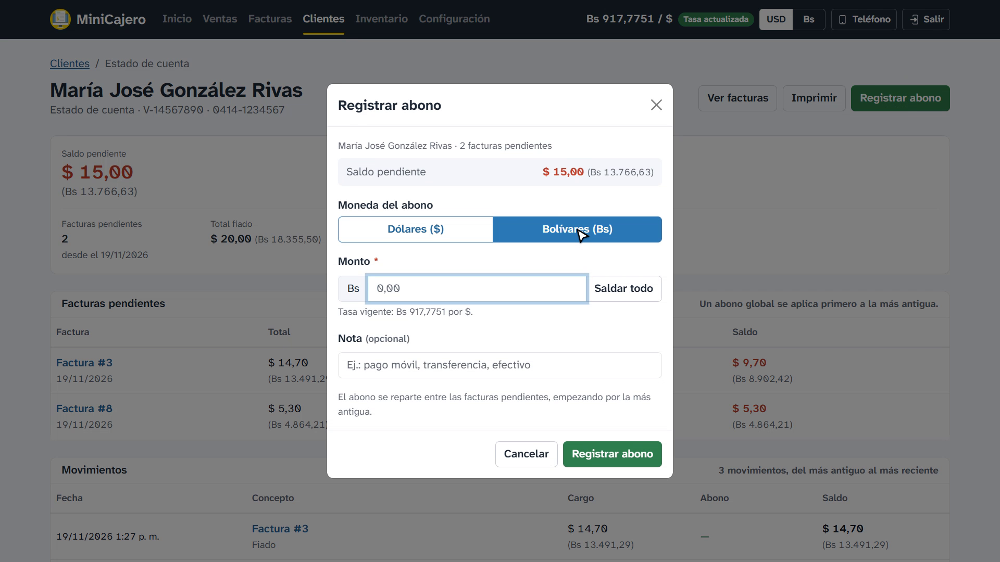
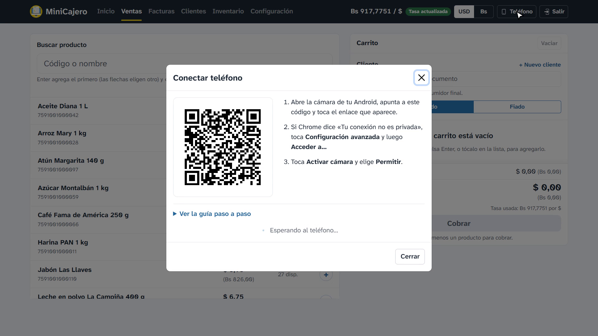

## Por qué

En una bodega venezolana, el dueño cobra él mismo en el mostrador, casi siempre con gente esperando. Los precios están en dólares, pero muchos clientes pagan en bolívares, así que cada venta pasa por la calculadora con la tasa del día. A los clientes de confianza se les fía, y esa deuda vive en una libreta. El inventario se cuenta a mano cuando hay tiempo.

Los sistemas de facturación que existen piensan en empresas: varios usuarios, roles, un servidor en la nube y una suscripción mensual. Para una persona sola, con una laptop modesta y una conexión que se cae, sobra casi todo eso. MiniCajero tiene éxito si cobrar una venta es más rápido que anotarla en el cuaderno.

## Cómo

**MiniCajero** es un servidor **Bun** en TypeScript estricto que escucha solo en `127.0.0.1` y guarda todo en **SQLite** con el módulo nativo `bun:sqlite`. Al abrirlo desde el acceso directo, arranca y abre el navegador predeterminado; si ya estaba abierto, solo abre otra pestaña. La única dependencia de ejecución es **Bootstrap**: no hay ORM, ni framework, ni librerías de PDF o de iconos.

*El inicio dice cuánto se vendió, cuánto se debe y qué productos se están acabando.*

Vender es el camino más corto de la app. Se busca o se escanea el producto, Enter lo agrega al carrito y F4 cobra, todo sin tocar el ratón. Cada monto se ve en dólares y en bolívares, y la venta se bloquea si no hay stock suficiente. La tasa oficial se sincroniza al arrancar y cada tres horas; si no hay internet, la barra lo avisa y el dueño puede fijar una tasa manual. Sin ninguna tasa, no se vende.

*Antes de anotar un fiado, la app enseña cuánto quedará debiendo el cliente.*

El fiado no tiene límite de crédito. Cada cliente tiene su estado de cuenta, y un abono se puede registrar en dólares o en bolívares: se reparte entre las facturas pendientes, empezando por la más antigua. Las facturas y los estados de cuenta se imprimen desde el navegador en carta o en ticket, o se guardan como PDF.

*Un abono en bolívares se convierte con la tasa del día y descuenta la deuda en dólares.*

## Desafíos

### El teléfono como escáner

Un lector de códigos de barras cuesta dinero, y el dueño ya tiene un Android con cámara. El problema es que el navegador del teléfono solo abre la cámara en una página segura, y la app escucha solo en la PC, sin HTTPS.

Al pedir el QR, la app enciende un **segundo servidor HTTPS** en la red local que solo sirve la página del escáner y su WebSocket; todo lo demás responde 404. Se apaga solo tras 15 minutos sin teléfonos. El certificado es EC P-256 autofirmado, y lo genero byte a byte en DER, sin OpenSSL, con las IP locales del equipo. El código QR también lo dibujo yo, con su corrección de errores Reed-Solomon, para no sumar dependencias.

*Se escanea el QR una vez, y cada código leído llega a la pestaña de Ventas o de Inventario.*

El QR lleva un token de un solo uso que caduca a los 10 minutos y que viaja en el fragmento de la URL, así que no aparece en ningún registro. En la base solo se guardan hashes. Cinco intentos fallidos bloquean esa IP. Cada lectura va a la pestaña de Ventas o de Inventario que se usó por última vez, y el teléfono recibe la respuesta en menos de cinco segundos: «Harina PAN · 2 en el carrito» o «Sin stock».

### Dos monedas sin errores de redondeo

Con una tasa de cientos de bolívares por dólar, un error de coma flotante se nota en el ticket. Los montos se guardan como enteros, en centavos de dólar y céntimos de bolívar. La conversión con la tasa, de hasta cuatro decimales, se hace con `BigInt`, y todo el redondeo sigue una única regla.

Los precios de los productos solo existen en dólares. Las facturas, en cambio, guardan los dos montos y la tasa usada al momento de la venta, y nunca se recalculan. Una venta y un abono corren dentro de una transacción `IMMEDIATE` de SQLite: hay una prueba que lanza ventas desde varios hilos a la vez y comprueba que ningún número de factura se repite.

### Un archivo y nada más

El dueño no va a instalar Node, ni una base de datos, ni dependencias. `bun build --compile` produce un solo `minicajero.exe` con el HTML, el CSS, Bootstrap y la tipografía dentro, y sin ventana de consola. Un **instalador en Rust**, escrito con el crate `windows` de Microsoft, lo instala solo para el usuario, sin pedir administrador, y crea los accesos directos. El desinstalador pregunta si borrar los datos y, por defecto, no los borra.

Un corte de luz no debe costar ventas. Cada día la app hace un respaldo con `VACUUM INTO`, que copia la base completa sin dejar archivos a medias, y conserva los 14 más recientes. Un respaldo se valida con `PRAGMA integrity_check` antes de restaurarlo.

### Lo que quedó fuera

MiniCajero no emite facturas con validez fiscal. Por ahora es para uso propio, con un solo usuario; si funciona, la idea es pasarlo a una app nativa con Tauri. El instalador de Windows todavía no está firmado, y la primera vez Chrome avisa en el teléfono de que el certificado no es de confianza.
