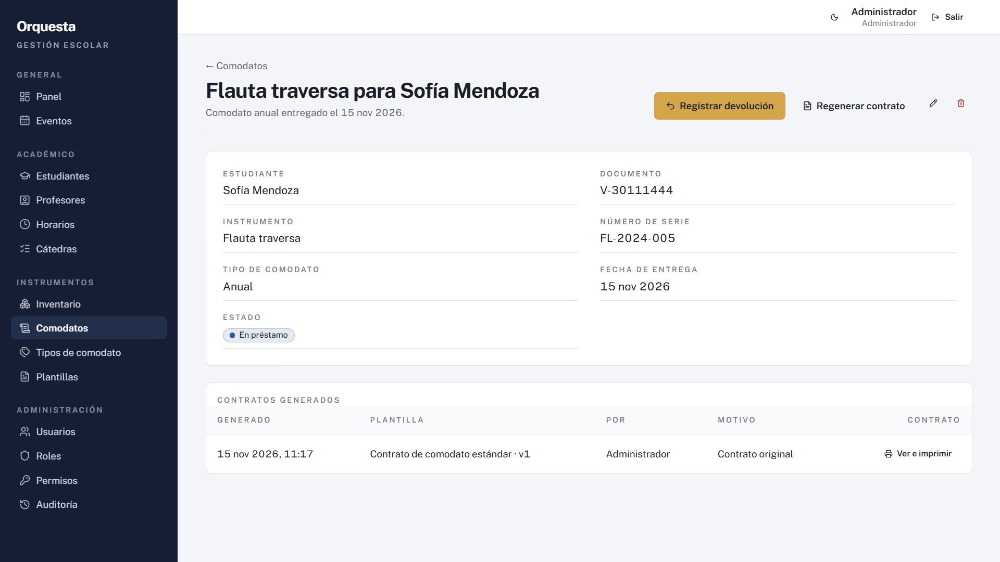
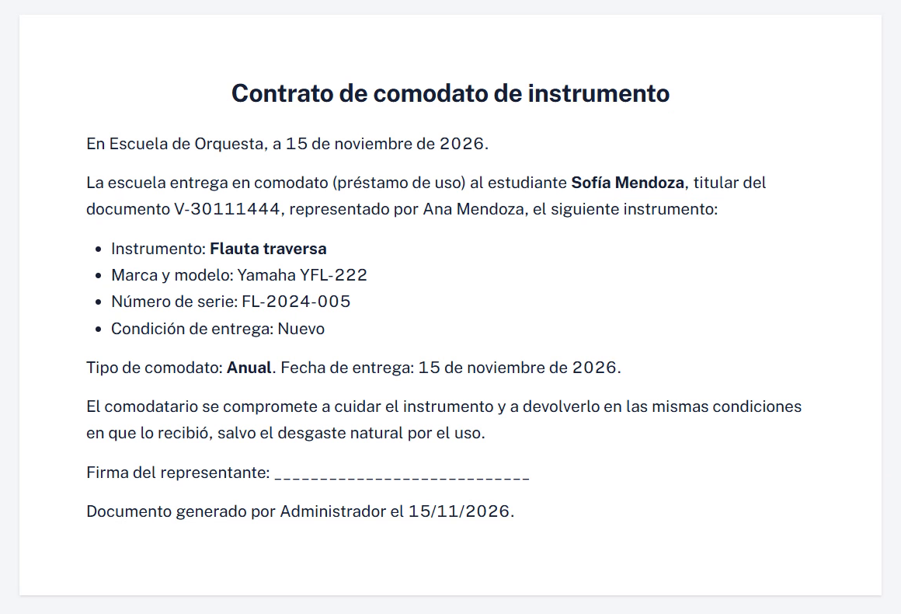
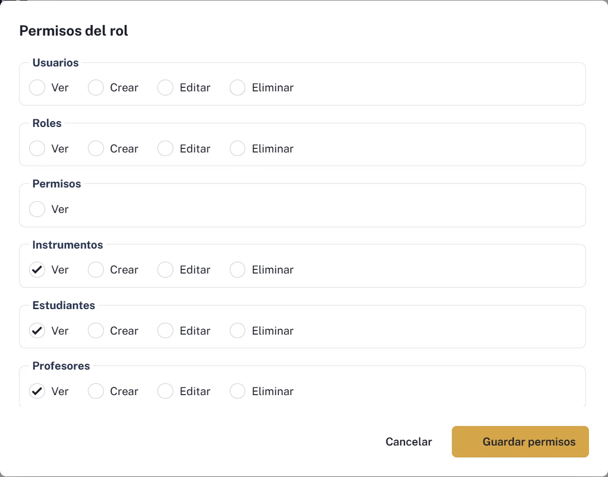
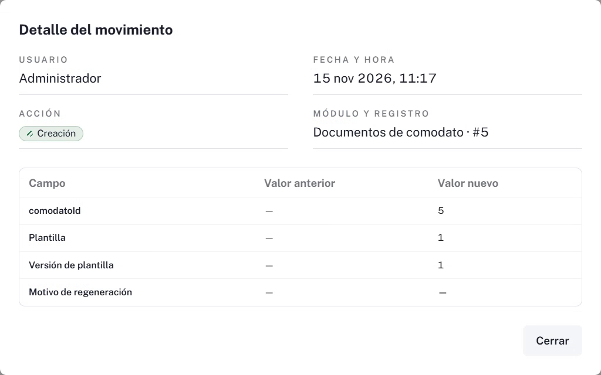
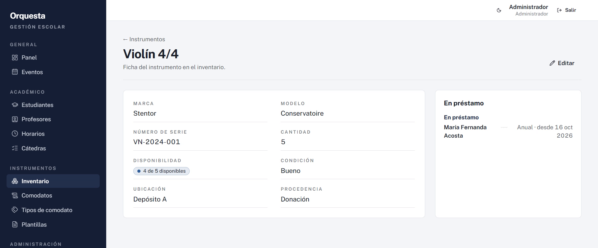

## Por qué

Una escuela de orquesta presta instrumentos, y presta muchos: violines, violonchelos, flautas y clarinetes que niños y jóvenes se llevan a casa para practicar. Cada préstamo es un **comodato**, un contrato de préstamo de uso que firma el representante. Cada instrumento tiene marca, número de serie, un estado y un lugar donde debería estar.

En muchas escuelas todo eso vive en papel y en hojas de cálculo sueltas. El resultado es el de siempre: nadie sabe con certeza cuántos violines quedan libres, el contrato se redacta a mano cada vez, y cuando algo cambia no queda rastro de quién lo cambió ni cuándo.

Antes de escribir código escribí el problema. Hice un documento por cada parte del sistema (acceso, usuarios y permisos, instrumentos, estudiantes, profesores, horarios, comodatos, eventos, auditoría y tablero) con sus casos de uso y sus reglas, y otro con cómo implementarla. Esos diez pares de documentos fueron el mapa de todo lo que vino después.

## Cómo

Orquesta ya pasó por tres versiones. La primera fue un monolito con Laravel e Inertia; la segunda, una API en NestJS con un cliente en Next.js. La actual es **una sola aplicación NestJS que corre sobre Bun** y arma cada página en el servidor con **hono/jsx**. **htmx** se encarga de lo dinámico (filtros, formularios, ventanas) pidiendo fragmentos de HTML, sin un framework en el navegador. Los datos viven en **MySQL** con **Drizzle ORM**, las entradas se validan con **Zod** y la interfaz usa **Tailwind CSS** y **daisyUI**.

El código se ordena por módulos (estudiantes, instrumentos, comodatos, plantillas, auditoría…), y cada módulo separa dominio, casos de uso, infraestructura y presentación, con un caso de uso por archivo. Las capturas usan los datos de demostración del proyecto.

*La ficha de un préstamo: quién lo tiene, qué instrumento, desde cuándo y cada contrato que se generó, con su motivo.*

### El contrato se escribe una vez

El centro del sistema es el comodato. Un administrador redacta el contrato en un editor que se usa como cualquier procesador de texto, hecho con TipTap, y donde lo necesita inserta datos del estudiante, del instrumento o del préstamo. No los escribe a mano: los elige de un catálogo y quedan en el texto como pastillas que se distinguen del resto. Una vista previa con datos de ejemplo muestra cómo va a quedar.

Al registrar un préstamo, el servidor resuelve cada dato con la información real (nombre, cédula, representante, número de serie, la fecha en formato largo) y guarda el resultado como una copia fija, junto con la versión de la plantilla que usó. Esa copia es la que vale: si mañana cambia la plantilla, los contratos ya firmados no se mueven. Si hay que corregir uno, se genera de nuevo y el anterior se conserva junto con el motivo del cambio.

*El contrato generado, listo para imprimir o guardar como PDF desde el navegador.*

### Cada quien ve lo suyo

Hay tres roles: administración, coordinación y profesores. Cada ruta pide un permiso concreto (ver, crear, editar o eliminar) módulo por módulo. Un profesor solo ve a los estudiantes y los préstamos de su horario, y esa regla se cumple tanto en los listados como cuando alguien intenta abrir un registro directamente por su dirección. El menú lateral se arma con los permisos de quien entra, así que nadie ve opciones que no puede usar.

*Los permisos de un rol, agrupados por módulo.*

### Nada cambia sin dejar rastro

Cada creación, edición o eliminación queda registrada con quién la hizo, cuándo, y el valor anterior y el nuevo de los campos que cambiaron. Las contraseñas y el contenido de los contratos nunca se copian a la auditoría. Los inicios y cierres de sesión también quedan anotados.

*Un movimiento en la auditoría: el administrador generó el contrato del comodato #5.*

## Desafíos

### Dos préstamos para el último violín

Un instrumento puede tener varias unidades, y la regla es simple: nunca se prestan más de las que hay. El problema aparece cuando dos personas registran a la vez un préstamo del mismo instrumento y queda una sola unidad libre. Si las dos consultan la disponibilidad antes de que la otra guarde, las dos ven «1 disponible» y las dos lo prestan.

La solución fue crear el comodato dentro de una transacción que bloquea la fila del instrumento (`SELECT … FOR UPDATE`) mientras cuenta los préstamos vigentes. La segunda petición espera su turno, encuentra cero unidades y recibe un mensaje claro.

*Cada instrumento muestra cuántas unidades quedan libres y a quién se prestó.*

### Una transacción sin pasarla de mano en mano

Registrar un préstamo toca tres cosas: el comodato, su contrato y su entrada en la auditoría. O se guardan las tres, o ninguna. La salida obvia, pasar la transacción como parámetro por cada repositorio, llena el código de ruido y basta un olvido para escribir fuera de ella. Usé el contexto asíncrono de Node (`AsyncLocalStorage`): al abrir una transacción queda guardada en ese contexto, y cada repositorio escribe en ella sin saberlo. Si un caso de uso llama a otro, el segundo se suma a la transacción del primero en vez de abrir una nueva.

### Cerrar sesión de verdad

La sesión no es un token que el navegador guarda por su cuenta: vive en la base de datos. La cookie lleva un valor aleatorio, `httpOnly`, y la base guarda solo su hash SHA-256, así que una copia de la base no sirve para entrar. Cerrar sesión borra esa fila; cambiar la contraseña o eliminar al usuario borra todas sus sesiones, y el acceso se corta en ese momento. Como el usuario y sus permisos se cargan en cada petición, si a alguien le quitan un permiso lo nota en su siguiente clic.

### Una plantilla es HTML que escribió alguien

El contrato se guarda como HTML, y lo que se guarda se vuelve a mostrar. Al guardar una plantilla, el servidor la limpia con el `HTMLRewriter` de Bun: solo pasan las etiquetas de texto, listas y tablas, y todo lo demás se descarta. Al generar el contrato, los datos de cada variable se escapan antes de entrar en el texto. Además, la página tiene una política de contenido estricta (`script-src 'self'`) y htmx funciona sin `eval`.

### Lo que quedó fuera

El PDF no se genera en el servidor. El contrato se guarda como HTML y se imprime o se guarda como PDF desde el navegador; fue una decisión deliberada para no depender de un navegador sin interfaz corriendo en el servidor. La interfaz está solo en español.
