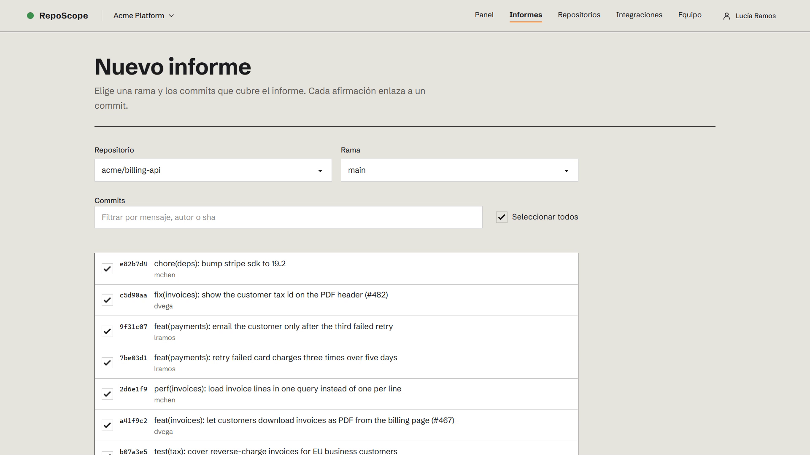
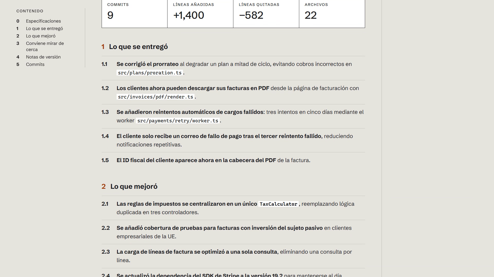
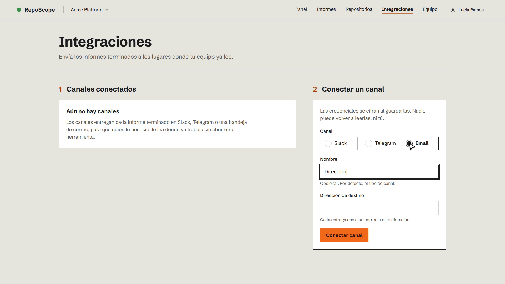
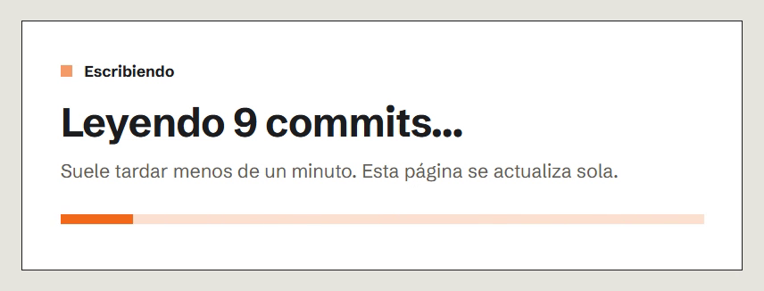
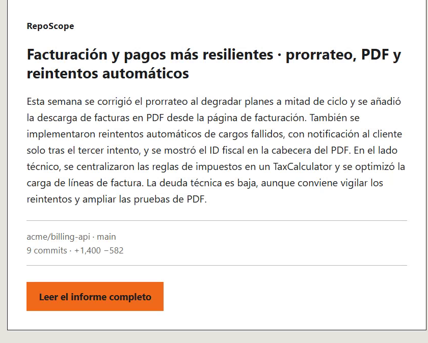

## Por qué

Cada semana o cada sprint, alguien en un equipo de software tiene que explicar qué se entregó a personas que no siguieron el trabajo de cerca: producto, dirección, un cliente interno. Esa persona vive en GitHub, pero su público no lee commits ni diffs.

Escribir ese informe a mano lleva su rato, y tiene un riesgo menos visible: lo que se cuenta de memoria no siempre coincide con lo que de verdad se subió. RepoScope parte de los commits reales y deja cada afirmación atada a uno de ellos.

## Cómo

El flujo tiene pocos pasos. Conectas repositorios de GitHub a un espacio de equipo, eliges una rama y marcas los commits que quieres cubrir, hasta 50. El informe sale en cuatro secciones (lo que se entregó, lo que mejoró, lo que conviene mirar de cerca y las notas de versión), y en el idioma que elijas para ese informe: español o inglés.

*Nuevo informe: repositorio, rama y los commits que va a cubrir.*

Es un monolito **Astro** en modo SSR, desplegable en Vercel, con **Supabase** para la base de datos y la autenticación (correo, GitHub OAuth y segundo factor con TOTP). No hay framework de cliente: las pantallas son formularios renderizados en el servidor, y la única interactiva de verdad, el selector de commits, es un *custom element* en TypeScript. Antes de elegirlo probé las tres opciones con esa misma pantalla: el custom element enviaba 0,6 KB de JavaScript, una isla de Preact 11,2 KB y Alpine.js 19,1 KB.

Hubo una versión anterior en Laravel, Inertia y React. Esta la reconstruí desde cero sobre Bun, con TypeScript en su modo más estricto, Biome y un script propio que rechaza archivos de más de 150 líneas.

### El informe es el producto

Leer y compartir el informe va antes que configurar nada. Cada punto lleva el sha corto de su commit y las líneas que añadió; el índice de partes, a la derecha, permite saltar de cualquier afirmación al commit que la respalda en GitHub.

*Cada punto numerado se puede seguir hasta su commit.*

El informe se comparte con un enlace público de solo lectura, que se puede revocar, o se imprime como PDF con una hoja de estilos de impresión. También se entrega a los canales que el equipo ya usa: un webhook de Slack, un bot de Telegram o el correo.

*Los canales se conectan una vez; las credenciales se cifran al guardarlas.*

## Desafíos

### Que el informe no invente

Un modelo de lenguaje escribe bien, y por eso mismo puede afirmar cosas que los commits no dicen. El pipeline no confía en el texto libre: le pide al modelo (DeepSeek, a través del **Vercel AI SDK**) una salida estructurada que se valida con **Zod**. Después la normaliza: respeta el orden de las secciones de la plantilla, recorta los puntos que sobran y deja como máximo tres etiquetas por punto.

Las referencias a commits se resuelven contra la lista que el usuario eligió. Si el modelo cita un sha que no está en esa lista, la referencia simplemente no aparece. Como el pipeline recibe el modelo como dependencia, los tests lo ejercitan con un modelo simulado, sin llamar a la API real.

### Un minuto de trabajo sin servidor propio

Generar un informe pide hasta 50 commits a GitHub y una llamada al modelo que puede tardar. La versión en Laravel lo resolvía con un worker de colas, pero en Vercel no hay procesos permanentes. La acción guarda el informe como pendiente, responde al momento y sigue trabajando con `waitUntil`. Las llamadas a GitHub van en paralelo, de ocho en ocho.

*Mientras escribe, la página consulta el estado cada 3 segundos y se actualiza sola.*

Para que una recarga o una petición repetida no lancen dos generaciones, el trabajo empieza «reclamando» el informe: solo pasa de `pending` a `generating` si seguía pendiente, y esa actualización la gana una sola petición.

### Secretos que el navegador nunca ve

RepoScope guarda tokens de GitHub con permiso sobre repositorios y la configuración de cada canal. Se cifran en la aplicación con AES-GCM (un IV aleatorio por mensaje y un formato versionado), y esas columnas no se pueden leer con el rol de un usuario normal. Todas las tablas tienen RLS en Postgres: el cliente con privilegios solo se usa en el servidor, después de comprobar el acceso con el cliente del propio usuario.

*Así llega el informe por correo.*

### Lo que quedó fuera

Solo hay un proveedor, GitHub. Si la función de Vercel muere antes de empezar, el informe se queda pendiente: no hay reintentos automáticos todavía. El producto aún no está desplegado en producción, y los vídeos usan un GitHub simulado con datos de demostración.
